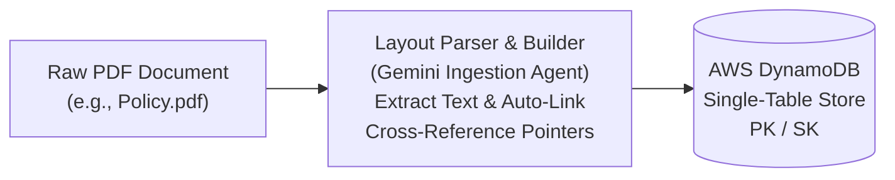
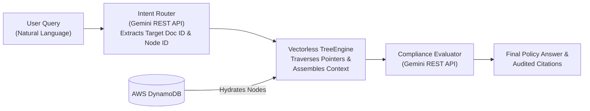

# Agentic Vectorless Tree-RAG Engine

> A deterministic, serverless RAG pipeline built on AWS and Google Gemini that eliminates vector databases, embeddings, and semantic loss through graph-based document traversal.

---

## 📌 Overview

Traditional Retrieval-Augmented Generation (RAG) architectures rely heavily on vector embeddings and similarity search (Cosine, Euclidean). While effective for broad semantic search, vector RAG often fails in complex, structured compliance environments (e.g., corporate policies, legal handbooks, academic regulations) due to chunk boundary truncation, loss of structural context, and non-deterministic retrieval jumps.

**Agentic Vectorless Tree-RAG** replaces high-dimensional vector math with a deterministic graph-traversal engine:

- **Zero Vector Math:** Eliminates embedding models and vector databases (Pinecone, PGVector, Qdrant).
- **Deterministic Pointer Traversal:** Navigates document hierarchies using explicit node pointers (`referenced_nodes`, `sub_clause_matrix`, `parent_rule`).
- **Structured Intent Routing:** Uses LLM function calling / JSON mode to translate natural language queries into exact document graph entry points.
- **Serverless & Cloud-Native:** Deployed on AWS single-table DynamoDB for on-demand scalability.

---

## 🏗️ Architecture & Pipeline Flow

### Independent Ingestion Pipeline



### Query Runtime Pipeline



---

## 🛠️ Features

- **LLM Intent Routing:** Translates natural language into structured graph node IDs using Gemini's JSON mode.
- **Deterministic Node Hydration:** Automatically traverses cross-reference links (e.g., Section 2.0 pointing to Section 4.2 out-of-station rules) with zero hallucinated jumps.
- **Resilient API Integration:** Built-in REST client featuring exponential backoff retries and model fallbacks (`gemini-3.8-flash` → `gemini-3.5-flash-lite` → `gemini-3.1-flash-lite`) to guarantee uptime during server traffic spikes.
- **AWS DynamoDB Single-Table Design:** Ultra-fast key-value document store using composite primary keys (`PK: DOC#<document_id>`, `SK: NODE#<node_id>`).
- **Automated PDF Layout Ingestion:** Ingests raw PDFs via `pypdf` and structures unstructured section blocks into strongly-typed `DocumentNode` objects.

---

## 📂 Project Structure

```text
vectorless-tree-rag/
├── ask_engine.py              # CLI query interface & handler runner
├── ingest_pdf.py              # PDF ingestion pipeline (PyPDF + Gemini + DynamoDB)
├── terraform/
│   └── dynamodb.tf            # IaC Terraform declaration for DynamoDB Single-Table
├── src/
│   ├── handlers/
│   │   └── query_handler.py   # Intent routing, synthesis, and REST API fallbacks
│   ├── retrieval/
│   │   ├── tree_engine.py     # Graph traversal engine
│   │   └── dynamodb_fetcher.py # Production AWS DynamoDB node fetcher
│   └── schemas/
│       └── document_tree.py   # Pydantic / dataclass schemas for DocumentNode
└── requirements.txt           # Python dependencies
```

---

## 🚀 Quickstart Guide

### Prerequisites

- Python 3.10+
- AWS Account & configured access keys (permissions for DynamoDB)
- Google AI Studio `GEMINI_API_KEY`

### 1. Clone & Set Up Virtual Environment

```bash
git clone https://github.com/csquare14/vectorless-tree-rag.git
cd vectorless-tree-rag

python3 -m venv .venv
source .venv/bin/activate
pip install -r requirements.txt
```

### 2. Configure Environment Credentials

```bash
# Configure AWS access keys
aws configure

# Export Gemini API key
export GEMINI_API_KEY="your-gemini-api-key-here"
```

### 3. Provision Infrastructure (AWS DynamoDB)

**Option A: Via Terraform**

```bash
cd terraform
terraform init
terraform apply -auto-approve
cd ..
```

**Option B: Via Python/boto3 (direct provisioning)**

```bash
python -c "
import boto3

client = boto3.client('dynamodb', region_name='us-east-1')
client.create_table(
    TableName='DocumentTreeStore',
    KeySchema=[
        {'AttributeName': 'PK', 'KeyType': 'HASH'},
        {'AttributeName': 'SK', 'KeyType': 'RANGE'}
    ],
    AttributeDefinitions=[
        {'AttributeName': 'PK', 'AttributeType': 'S'},
        {'AttributeName': 'SK', 'AttributeType': 'S'}
    ],
    BillingMode='PAY_PER_REQUEST'
)
"
```

---

## 📄 Ingesting Custom PDFs

Ingest any raw policy or regulation PDF into your cloud database in one command:

```bash
python ingest_pdf.py <document_id> <path_to_pdf>
```

**Example:**

```bash
python ingest_pdf.py srm_academic_policy_2026 srm_academic_policy_2026.pdf
```

---

## 💬 Running Queries

Query your live AWS infrastructure and receive deterministic, policy-compliant evaluations:

```bash
python ask_engine.py 'I am an SRM student attending a hackathon in Bangalore for 4 days. Can I get duty leave and what forms do I need?'
```

### Example Terminal Output

```text
======================================================================
USER QUERY: I am an SRM student attending a hackathon in Bangalore for 4 days. Can I get duty leave and what forms do I need?

--- SYSTEM RESPONSE ---
You CAN obtain Duty Leave, provided you complete the required approval and
clearance procedures prior to your departure.

Here is the breakdown of your request based on the policy:

Duty Leave Limits vs. Requested Duration:
  - Under Section 2.0, the allowance limit for Inter-University Technical
    Fests / Hackathons is capped at a maximum of 10 Days per semester.
  - Your requested duration of 4 days falls within this allowable limit.

Mandatory Approvals:
  - You must obtain mandatory approval from the Head of Department (HOD)
    for Inter-University Technical Fests / Hackathons.

Required Form Numbers and Travel Clearance Rules:
  - Because Bangalore involves out-of-station, inter-state travel outside
    Tamil Nadu (Section 4.2), you must obtain pre-approval prior to departure.
  - You are required to submit:
      * A signed parent authorization consent form.
      * Form TRV-204, which must receive an official clearance stamp from
        the Department Office prior to travel.

CITATIONS USED : ['section_2.0', 'section_4.2', 'section_1.0', 'section_3.1']
NODES HYDRATED : 4
```

---

## 🔬 Data Schema Design

**AWS DynamoDB Single-Table Schema (`DocumentTreeStore`):**

| Entity Type   | Partition Key (PK)   | Sort Key (SK)    | Attributes                                                              |
|---------------|----------------------|------------------|-------------------------------------------------------------------------|
| Document Node | `DOC#<document_id>`  | `NODE#<node_id>` | `title`, `content`, `parent_rule`, `referenced_nodes`, `sub_clause_matrix` |
| Meta Index    | `DOC#<document_id>`  | `META#INDEX`     | `summary`, `available_node_ids`, `section_map`                          |

---

## 📜 License

Distributed under the MIT License. See [`LICENSE`](LICENSE) for details.
